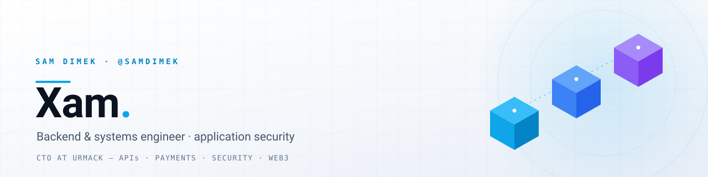

<picture>
  <source media="(prefers-color-scheme: dark)" srcset="assets/banner-dark.svg">
  <source media="(prefers-color-scheme: light)" srcset="assets/banner-light.svg">
  
</picture>

  
  
  

I build the parts of software that have to keep working: **backend systems, APIs, integrations and payments** — with **application security** treated as a design constraint rather than a review step. CTO at **Urmack**, engineer by craft.

### Building now

**[Nakudai](https://github.com/samdimek/Nakudai)** — a decentralized lending protocol. Just started, in progress.

### Featured work

| Project | What it is | Built with |
| :--- | :--- | :--- |
| **[goku](https://github.com/samdimek/goku)** | Aave V3 flash-loan arbitrage engine. Solidity strategy registry with an atomic min-profit guard and owner/keeper auth, plus an off-chain scanner that quotes → prices gas → simulates on-chain → sends, and a P&L ledger rebuilt from `FlashLoanExecuted` events. | `Solidity` `Hardhat` `Node.js` |
| **[electroHub](https://github.com/samdimek/electroHub)** | Multi-vendor electronics marketplace, end to end: vendor onboarding gated to electronics categories, catalog and inventory with movement history, order operations, promotions, warranties, RBAC and an immutable audit log on every state change. | `Next.js` `Prisma` `PostgreSQL` `Stripe` `Redis` |
| **[xamdimek-site](https://github.com/samdimek/xamdimek-site)** | Turborepo monorepo running the public site: marketing pages, blog, auth, marketplace listings and a service-desk ticketing app, with shared `ui`, `db`, `auth` and `types` packages. | `Next.js` `TypeScript` `pnpm` `Turborepo` |
| **[DImek](https://github.com/samdimek/DImek)** | Portfolio plus a real Stripe storefront on Vercel serverless functions: hosted Checkout with cart quantities, a monthly subscription, 3-D Secure when the issuer asks for it, and verified webhook fulfilment. | `Serverless` `Stripe` `HTML` |

### How I work

| Build | Secure | Operate |
| :--- | :--- | :--- |
| Full-stack web apps, REST APIs, backend systems, databases, payment and third-party integrations, business automation | Auth and RBAC, API and web app security, vulnerability assessment, secure coding, Linux and networking, security testing | Docker, CI/CD, cloud deployment, Linux administration, monitoring, documentation, production troubleshooting |

### Stack

  
  
  
  
  

**Backend & web**

  
  
  
  
  
  

**Data**

  
  
  
  

**Infrastructure & cloud**

  
  
  
  
  
  

**Payments, Web3 & AI**

  
  
  
  
  

**Security tooling**

  
  
  
  
  
  

### Activity

  <picture>
    <source media="(prefers-color-scheme: dark)" srcset="https://github-profile-summary-cards.vercel.app/api/cards/profile-details?username=samdimek&theme=github_dark">
    <source media="(prefers-color-scheme: light)" srcset="https://github-profile-summary-cards.vercel.app/api/cards/profile-details?username=samdimek&theme=github">
    
  </picture>

---

  Happy to talk shop about backends, payments or security — say hi on <a href="https://x.com/samdimek">X</a>.

